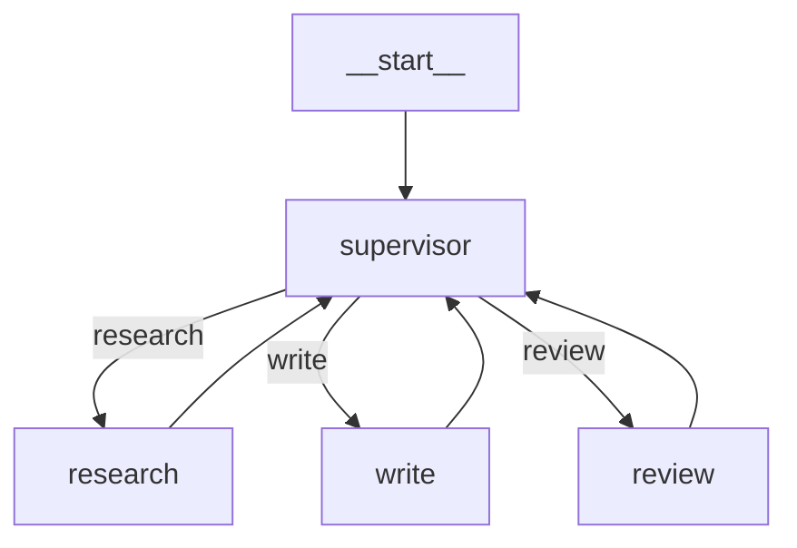

# 架构说明

## 分层与依赖方向

```
            graph.py            流程编排（节点 + 边 + checkpoint）
               │
           agent.py            控制循环（唯一有「模型交互」的地方）
               │
    ┌──────┼───────────┬──────────┐
    ▼      ▼           ▼          ▼
tools.py  providers/  tracing.py  memory.py
    │          │
    ▼          ▼
schema.py   types.py  ←── 所有层共享，依赖最稳定

checkpoint.py ── 只被 graph.py 依赖（存储契约，可替换）
memory.py ── 只被 agent.py 依赖（上下文与长期记忆，不反向依赖）
```

依赖**单向向下**：上层可以用下层，下层永远不知道上层存在。
好处是替换任意一层都不用碰其它层 —— 换 LLM 后端只动 `providers/`，
改循环策略只动 `agent.py`，改编排方式只动 `graph.py`。

## 各层职责

### `types.py` —— 通用货币

`Message` / `ToolCall` / `ToolResult` / `Usage` 全部是 **frozen pydantic 模型**。

- 不可变：一次运行中可以安全地到处传递，不用担心被某层偷偷改掉
- 可序列化：`to_api_payload()` 一处实现 OpenAI 线格式，所有后端复用
- `ToolCall.arguments` 带一个校验器：模型经常把参数传成 JSON 字符串而不是对象，这里统一兜住

### `schema.py` —— 代码即描述

工具描述从**运行时签名**生成，而不是手写的字典。这消除了最常见的
一类 bug：函数加了参数，但给模型的描述忘了改。

两个设计决定：

1. **无法识别的注解返回 `{}` 而不是抛异常。**
   一个冷门类型不该毁掉整个工具注册。宁可让模型看到「任意值」，
   也不要让服务起不来。
2. **`additionalProperties: false`。**
   默认拒绝模型编造未声明的参数，把幻觉挡在执行之前。

docstring 解析同时支持 Google 和 numpy 风格，并且会识别 `Returns:` /
`Raises:` 等段头 —— 否则「Returns」会被当成一个参数名。

### `tools.py` —— 校验 + 隔离

```
模型参数 ──► pydantic 动态模型 ──► 校验并强转 ──► Python 函数
                  │                                    │
                  └─ 失败：InvalidToolArguments          └─ 抛异常
                          │                                    │
                          └──────────► ToolResult(is_error) ◄──┘
```

关键点：**工具的失败是数据，不是控制流**。
`invoke()` 永远返回 `ToolResult`，绝不向上抛。这样 Agent 循环不会被一个
坏工具打断，而是把错误交给模型去补救。

`ToolRegistry` 是模型能碰到工具的唯一入口，因此「某个 Agent 能用哪些工具」
这件事有单一事实来源，`restricted_to()` 可以按角色裁剪工具集。

### `providers/` —— 唯一依赖外部世界的边界

用 `Protocol`（结构化类型）而不是抽象基类：

```python
class LLMProvider(Protocol):
    def generate(self, request: GenerateRequest) -> LLMResponse: ...
```

任何有这个方法的对象都是合法 provider —— 测试替身、缓存装饰器、
fallback 链都不需要继承任何东西。

- `ScriptedProvider`：回放脚本，**也可以传一个函数**按请求动态返回，
  于是「模型看到工具结果之后的反应」也能被精确断言
- `OpenAICompatibleProvider`：支持注入 `httpx.Client`，测试时用
  `MockTransport`，生产时用真实连接；对 429/5xx 做指数退避重试

### `agent.py` —— 循环

只有四件事：调模型、跑工具、判断结束、记账。

三个容易做错的细节，这里都处理了：

1. **连续失败计数跨轮累计**（不是每轮重置）。
   否则「模型反复用同一个坏工具」永远触发不了上限。
2. **跑满步数时回退到最后一条 assistant 文本**，而不是返回空字符串。
3. **`while ... else` 区分「break 出来」和「条件耗尽」**，
   所以 `MAX_STEPS` 不会和 `FINAL` 混淆。

### `graph.py` —— 流程编排

单 Agent 适合「一件事」，真实任务是「检索 → 够不够 → 写作 → 审校 → 不过就重写」。
写成 `if/elif` 也能跑，但很快没人敢改。这里把**节点**和**边**分开：

- **节点是纯函数**：`(state) -> 局部更新`，不知道自己前后是谁
- **边是数据**：静态边就是 `dict[source, target]`，条件边是 `(router, mapping)`
- **流程因此可以被检查**：`compile()` 会校验入口、边的目标、以及不可达节点

四个刻意的设计决定：

1. **节点返回局部更新，不是整个新状态。**
   这样节点只依赖它真正关心的字段，加字段不用改所有节点。
2. **默认最后写入生效，累积字段显式注册 reducer。**
   `StateGraph({"messages": append})`。两个节点都写 `messages` 时不会互相覆盖 ——
   这是多智能体里最常见的隐蔽 bug。
3. **节点拿到的是只读视图（`MappingProxyType`）。**
   想直接 `state["x"] = 1` 会当场 `TypeError`，而不是悄悄影响后面的节点。
4. **跑满步数 / 节点抛异常都进 `GraphStatus`，不假装有结果。**
   失败的运行仍然带完整 trace 和已经跑出来的状态，方便定位。



### `checkpoint.py` —— 存储契约

`Checkpoint` = 线程 id + 步数 + 完整状态 + 下一个节点。存储本身只是一个 Protocol，
内存实现保留**全部历史**（排查「状态在哪一步跑偏」时很有用）。

「没有出边的节点 = 这条分支结束」，所以流程可以自然地停在中间等人类 ——
人在外部改状态、写回同一条线程，`resume(thread_id)` 接着跑完，前面的节点不会重跑。

### `memory.py` —— 上下文与长期记忆

两个问题要分开看，混在一起就会两边都做不好：

1. **上下文**：这一次请求里塞哪些消息。窗口是硬约束，塞不下就是 400。
2. **长期记忆**：跨会话的事实，按相关性捞回来。

#### 裁剪必须按「组」，不能按「条」

OpenAI 兼容接口有一条硬规则：`role=tool` 的消息必须紧跟带 `tool_calls` 的
assistant 消息，否则请求直接失败。所以裁剪的最小单位是**原子单元**：

```
assistant(tool_calls=[c1, c2])  ┐
tool(c1)                        ├─ 一个单元：要么全留，要么全丢
tool(c2)                        ┘
```

只按条数丢，就会出现「tool 结果还在、发起调用那条没了」的非法请求 ——
这是长对话 Agent 最常见的线上事故之一，测试里专门有一条断言防它。

四个刻意的决定：

1. **system prompt 和第一条 user 消息钉住不裁。** 前者是人格与规则，后者是任务
   本身；丢了它们，模型会开始答非所问。
2. **开了摘要就先预留 1/4 预算。** 不做预留时，贪心填充会把预算吃到只剩几 token，
   摘要永远「差一点放不进去」—— 功能写了等于没写。
3. **窗口不从裸 assistant 回复开始。** 它回答的问题已经被裁掉了。带 `tool_calls`
   的除外：后面挂着的工具结果是有用状态。
4. **最新的请求即使超预算也留下**，并在 `ContextStats.truncated` 里如实标记。
   宁可超出一点，也不能把用户当前的问题扔掉。

#### 估算、检索、摘要都是协议

| 协议 | 默认实现 | 为什么是这个默认 |
| --- | --- | --- |
| `TokenEstimator` | `HeuristicTokenEstimator`（CJK 1 字符 ≈ 1 token，ASCII 4 字符 ≈ 1 token） | 精确分词要绑死某个模型的分词器，这里只需要「别超预算」，误差 ±15% 足够 |
| `MemoryStore` | `InMemoryMemoryStore`（BM25-lite） | 零依赖、零延迟、结果确定；换 SQLite/pgvector 不影响调用方 |
| `Summarizer` | `ExtractiveSummarizer` / `LLMSummarizer`（失败自动降级） | 没有 API Key 时也能压缩，否则「记得住」在测试里就是假的 |

中文检索不用 jieba：连续的 CJK 串切字符 bigram（`景德镇陶瓷` → 景德 / 德镇 /
镇陶 / 陶瓷）。不需要词典，召回明显好于单字，排序仍然是确定的 —— 测试可以断言
「哪条排第一」，而不是断言「大概能找到」。

### `tracing.py` —— 事件流

扁平的事件列表，不引入 OpenTelemetry。
理由：当前目标是「看清一次 run 发生了什么」，一条能断言、能序列化的
列表就够了。将来要接 OTel，也只是把事件转成 span。

## 关键取舍

| 决定 | 选了 | 没选 | 为什么 |
| --- | --- | --- | --- |
| 工具执行 | 串行 | 并行 | 并行让 trace 不确定、错误处理复杂化 |
| 工具报错 | 转成数据回喂 | 直接抛 | 让模型自我纠错，比写重试逻辑便宜 |
| Provider | Protocol | ABC | 测试替身不必继承 |
| 未知注解 | 返回 `{}` | 抛异常 | 一个类型不该拖垮整个注册 |
| 追踪 | 自带事件流 | OpenTelemetry | 现阶段不需要分布式追踪的重量 |
| 消息模型 | frozen | 可变 | 一次运行中到处传，可变是隐患 |
| 图状态 | 普通 dict | 自定义 State 类 | 序列化、合并、调试都更简单 |
| 状态合并 | 默认覆盖 + 显式 reducer | 全部累积 | 让「两个节点写同一字段」的冲突暴露出来 |
| 节点可见性 | 只读视图 | 直接传 dict | 就地修改是最难查的一类 bug |
| 流程定义 | 先构建后 `compile()` 校验 | 边加边跑 | 跑不起来的图根本编译不过 |
| 节点报错 | 记录进 status + trace，不再往下走 | 自动重试 | 重试策略该由调用方决定，不该藏在框架里 |
| 上下文裁剪单位 | 原子单元（assistant + 它的 tool 结果） | 单条消息 | 单条裁剪会拼出非法请求 |
| 超预算的最新消息 | 保留并标记 | 丢弃 | 丢当前问题比超预算更糟 |
| 摘要空间 | 预留 1/4 预算 | 与历史共享剩余空间 | 不预留则摘要永远塞不进去 |
| 摘要器 | 协议 + 离线兜底 | 只支持 LLM | 测试与示例不能依赖 API Key |
| 检索 | BM25-lite + 中文 bigram | 向量库 | 规模不大时确定性和零依赖更值钱 |

## 已知限制

- 图是**串行**执行：没有并行分支（fan-out / fan-in）。真实需要并行的场景目前只能在
  一个节点内部自己并发
- 无异步接口 —— 图里的节点如果跑 Agent，会阻塞（v0.4.0 配合 FastAPI 一起加）
- `Checkpointer` 只有内存实现；`ScriptedProvider` 之外的 provider 在图里跑会真的花钱
- 记忆只有内存实现（进程退出即丢）；`MemoryStore` 是协议，接 SQLite/Redis 是下一步
- 检索是关键词式：同义词和改写查询召回不到（要语义检索得上 v0.5.0 的 RAG）
- 摘要不保证事实无损：压缩比高时细节会丢，关键约束应显式写进 system prompt
- 只支持 function-calling 风格的工具调用，不支持从纯文本里解析 ReAct 格式
